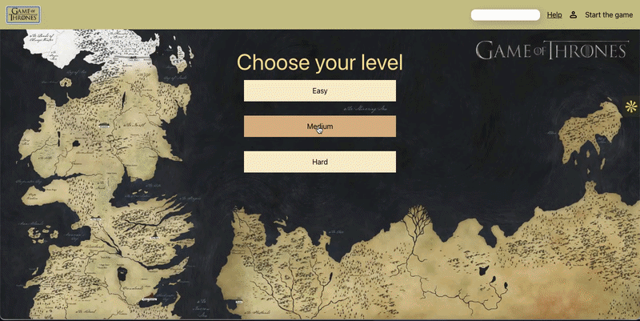

# Memory Card Game

A full-stack memory game where a deck of cards is generated on demand. Type any theme: "deep sea", "vintage cameras", "medieval armour"; and an LLM generates the card set while an image model illustrates it.

🎮 **Live demo:** [card-game.ianadev.com](https://card-game.ianadev.com)



---

## The game

The game essentially is a hybrid between "Memory Loop" and "Shuffle table" where the challenge isn't remembering *where* the cards were, but about keeping track of which card you've already interacted with while the board constantly shifts.

You can test your memory with 3 different levels of difficulty: 5, 10 and 15 cards.

Three difficulty levels, each with its own board size and scoring multiplier.

Decks are generated from a user-supplied theme, cached, and reused.

---

## How deck generation works

```
User types a theme
      ↓
POST /generate-cards ──→ gpt-5-nano ──→ 15 × { name, imagePrompt }
      ↓                                  (JSON Schema enforced)
  cached in PostgreSQL
      ↓
POST /generate-images ─→ job queued in Redis ─→ returns { jobId }
      ↓                                              ↓
 frontend polls GET /job/:id              BullMQ worker:
      ↓                                   15 × gpt-image-1-mini
      ↓                                   → sharp (512px WebP)
      ↓                                   → Supabase Storage
 cards + imageUrls ←──── PostgreSQL ←───── UPDATE with URLs
```

Two models, chained: the text model turns one vague word into fifteen distinct, specific image prompts — the part only an LLM can do — and those prompts become the input to the image model.

---

## Features

- **AI-generated decks** — any theme, generated once and cached
- **Background job processing** — image generation runs in a queue, not in the request
- **Accounts** — sign up, email verification, login, profile with custom avatar
- **Score history** — every game stored: score, difficulty, date
- **XP and ranks** — computed from full game history rather than stored as a running total
- **Achievements** — unlocked from gameplay stats
- **Animated UI** — card flip animations, loading states, Lottie screens

---

## Tech stack

**Frontend** — React, TypeScript, Vite, Framer Motion, Lottie, multi-context state management

**Backend** — Node.js, Express, REST API, JWT auth, Zod validation, Resend (transactional email)

**AI** — OpenAI `gpt-5-nano` (structured output via JSON Schema), `gpt-image-1-mini` (image generation)

**Jobs** — BullMQ + Redis (Upstash), status polling

**Media** — sharp (resize + WebP conversion), Supabase Storage

**Data** — PostgreSQL (Supabase), `jsonb` for generated card sets

**Infrastructure** — Netlify (frontend), Render (backend), custom domain via OVH

---

## Technical decisions

**Image generation runs in a background queue.** A single image takes ~12 seconds. Fifteen fired in parallel took ~50s rather than ~12s, because the provider throttles concurrent image requests — so a full deck is 60–90 seconds, far past any HTTP timeout. The request now enqueues a BullMQ job and returns a job ID immediately; the frontend polls a status endpoint until the worker finishes. The queue also provides concurrency control, which is what keeps the generation inside the provider's rate limit.

**Structured output, not prompt instructions.** Asking the model nicely for JSON produced valid JSON with drifting *shape* — `name` became scene titles on one run and plain nouns on the next, with no error thrown and no way for the frontend to notice. The card set is now constrained by a JSON Schema in strict mode and validated at runtime with Zod, so malformed output fails loudly at the boundary rather than silently downstream.

**Reasoning effort tuned after profiling token usage.** The first working call spent 1,408 of 1,614 output tokens on reasoning that is never shown to the user — 87% of the output cost. Setting `reasoning: { effort: "low" }` cut output tokens roughly 6× for the same result.

**Images optimised before storage.** The image API returns 1024×1024 PNGs at ~1.1 MB each; a card renders at a fraction of that size. Running each one through sharp — resize to 512px, convert to WebP — brings it to ~12 KB, a ~90× reduction. For a 15-card deck that's ~180 KB instead of ~16 MB, which matters both for storage limits and for how fast a board loads on mobile.

**Generated decks are cached in PostgreSQL, not Redis.** Each deck costs real money to produce, so it has to survive a cache eviction. The cards live in a `jsonb` column — they're always read and written as a complete set and never queried individually, so normalising into a separate table would add joins without adding anything. Redis holds only the jobs, which are inherently temporary.

**Provider errors mapped to application error codes.** The image model rejects prompts it reads as copyrighted characters — and because the *LLM* writes those prompts, an innocent user theme can still produce a blocked one. Safety rejections, rate limits and network failures are mapped to typed error codes so the frontend can show a useful message instead of hanging on a loading screen.

**XP is computed, not stored.** Ranks and XP totals are derived from the game history table on each request rather than kept as a counter on the user row. Slightly more expensive per query, but it guarantees consistency: if the scoring formula changes, the whole history stays correct without a migration, and XP can't drift out of sync with actual games played.

**Stateless authentication.** Frontend and API deploy separately, so auth uses JWTs in the `Authorization` header rather than server-side sessions — no shared session store between services. Email verification uses a separate short-lived token.

**Database migration mid-project.** Started on Neon, moved to Supabase to consolidate the database and avatar storage in one place. Migrating a live schema turned out to be an education in itself.

---

## Running locally

```bash
git clone https://github.com/<username>/<repo>.git
cd <repo>

# frontend
npm install
npm run dev

# backend (second terminal)
cd backend
npm install
npm run dev
```

The worker runs in the same process as the API in production. To run it separately during development:

```bash
cd backend
npm run worker
```

**Environment variables** — create a `.env` in the project root:

```
DATABASE_URL=            # PostgreSQL connection string (Supabase pooler)
SUPABASE_URL=            # Supabase API URL, for storage
SUPABASE_SECRET_KEY=     # service role key — server only, never exposed
OPENAI_API_KEY=          # text + image generation
REDIS_URL=               # Redis connection, for the job queue
JWT_SECRET=              # signs auth tokens
RESEND_API_KEY=          # transactional email
FRONTEND_URL=            # frontend origin, for CORS and email links
```

---

## Roadmap

- [ ] **Progressive image loading** — update the deck as each image lands rather than waiting for all fifteen, so cards populate one by one
- [ ] **True job cancellation** — currently cancelling stops the polling but not the in-flight API calls; proper cancellation needs an `AbortController` threaded through the worker and a cross-process cancel signal
- [ ] **Global leaderboard**
- [ ] **Automated tests** on the authentication and generation routes
- [ ] **Semantic card reuse** — match cards across themes by meaning (pgvector + embeddings) rather than regenerating similar subjects

---

## Known trade-offs

- Polling is hand-rolled; TanStack Query's `refetchInterval` or server-sent events would be the production choice.
- The worker runs in the API process rather than as a separate service — the architecture supports splitting them (they share only Redis), but a single process is cheaper at this scale.
- Deck generation costs roughly $0.08 per new theme, which is why caching and per-request validation exist.

---

Built by [Iana Averianova](https://www.linkedin.com/in/iana-averianova/) — full-stack developer (TypeScript, React, Node.js, PostgreSQL).